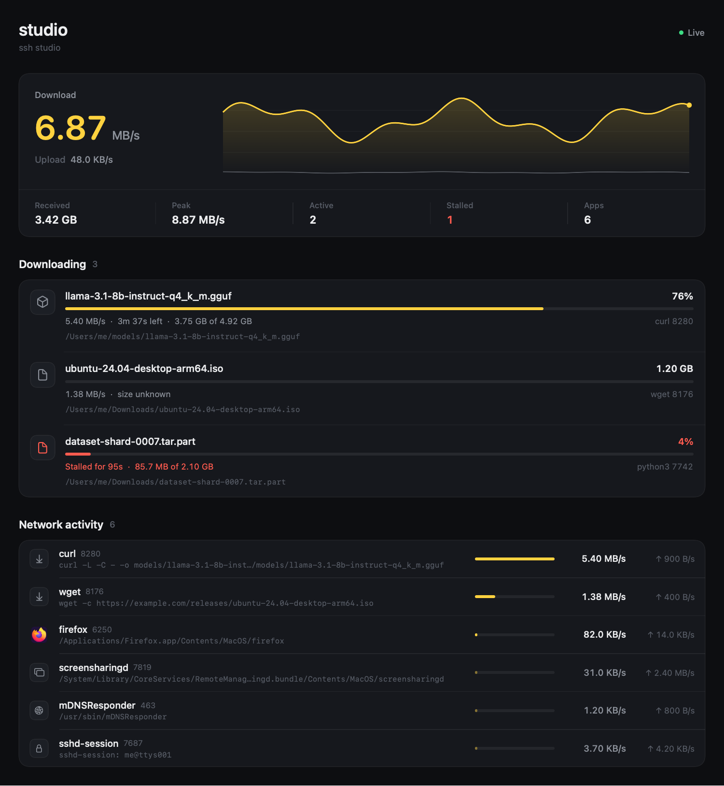

# Dolkoon

A small native macOS app that shows what is downloading on your Mac right now — and on any other Mac you can reach over SSH.



## What it shows

- **Live speed** — total download and upload, with a 90-second chart.
- **Downloading** — every file a network app is writing, with progress, size, speed and ETA. A file that stops growing for 20 seconds is marked **stalled**.
- **Network activity** — every process using the network, its speed and its full command line, with the real app icon when there is one.
- **Machines** — this Mac plus any SSH host you add in the sidebar (uses your `~/.ssh/config` aliases and keys).
- **Menu bar** — total download speed, and the top files per machine in a popover.
- **Packets** — see what your Mac is saying on the network, explained for anyone:
  - **Stories**: each packet as one plain sentence ("Safari on your Mac started a secure, encrypted conversation with example.com"), with why it happens. Repeats fold into one line, and TCP "got it" replies hide by default.
  - **App**: which app sent or received each packet (matched by port with `lsof`), with its real icon.
  - **Journey**: an animation of the packet going down your Mac's 7 OSI layers, picking up a header at each one, across the wire, and up the other side.
  - **Inside the packet**: every layer, what it adds (bytes and fields), a letter-in-the-post analogy, and what each value means; plus a header bar and a hex dump coloured by layer.
  - **Conversations**: who your Mac is talking to, busiest first, with the app, the service and whether it was encrypted.
  - Quick filters (Websites, Name lookups, Nearby devices, Encrypted, Readable), an "encrypted %" meter, a classic table view, `.pcap`/`.pcapng` open and save, and demo packets.
  Decodes Ethernet, ARP, IPv4/6, ICMP, TCP, UDP, DNS/mDNS, TLS (server name), QUIC/HTTP/3, HTTP, SSH, DHCP and SSDP.

### Packet capture permission

macOS only lets members of the `access_bpf` group read packets. If you have Wireshark's ChmodBPF installed, the **Allow capture…** button adds you to that group (it asks for your password). Without ChmodBPF, install it from `Wireshark.app/Contents/Resources/Extras`. Dolkoon captures in non-promiscuous mode, so it only sees this Mac's own traffic.

## How it works

Once a second Dolkoon runs a short shell script, locally or over SSH:

- `nettop` for per-process bytes in/out over the last second,
- `ps` for each busy process's command line,
- `lsof` for the files those processes have open for writing.

When a process's command line has a URL (e.g. `curl`, `wget`), Dolkoon sends a `HEAD` request to learn the full size, so it can show a percentage and ETA. Remote hosts reuse one SSH connection (`ControlMaster`), so polling stays cheap. Nothing is installed on the remote Mac.

## Build

Requires macOS 14+ and the Xcode command line tools (Swift 5.10+). No Xcode project needed.

```bash
./build.sh
open ~/Applications/Dolkoon.app
```

`build.sh` compiles `Sources/*.swift` into `Dolkoon.app` and copies it to `~/Applications`.

To add a remote Mac, type its SSH host name into the sidebar field. It must accept key-based login (`ssh <host>` works without a password prompt).

## Development

`./render.sh [dir]` renders the main views with sample data to PNG files, handy for checking layout without running the app.
